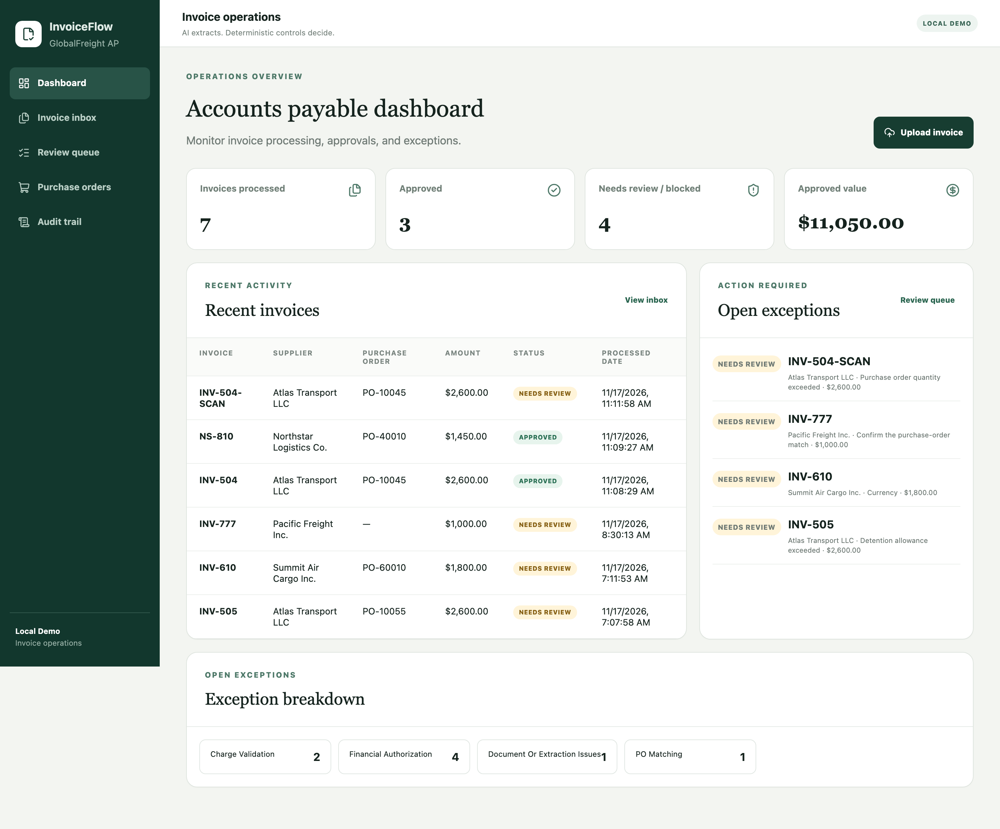
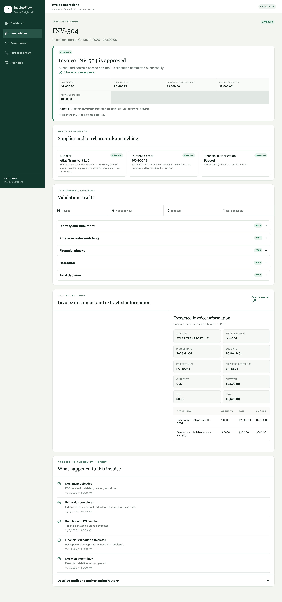
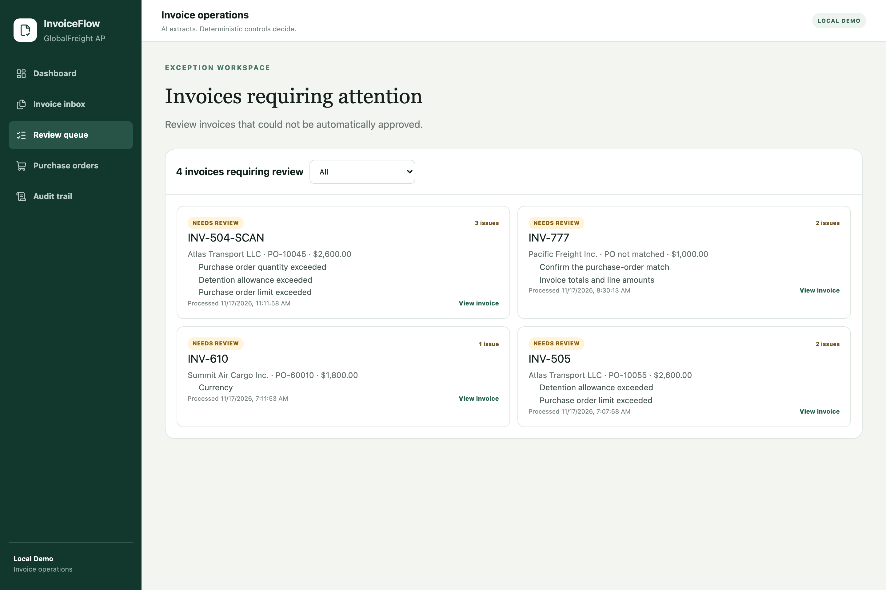
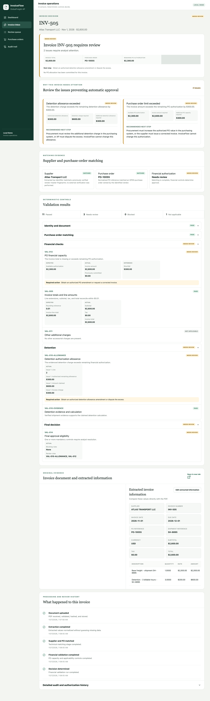

# InvoiceFlow

InvoiceFlow is a real PDF invoice-processing application for the fictional GlobalFreight AP operation. Gemini extracts document evidence; deterministic services perform supplier/PO matching, duplicate detection, financial validation, decisions, and transactionally safe PO allocation.

InvoiceFlow is not an ERP or procurement approval system. AP analysts can correct supported extraction errors and confirm eligible PO matches. The application cannot increase financial authorization, override controls, post payments, or manually set an invoice to approved.

## Run locally

Prerequisites: Python 3.12+, Node.js 20+, and npm.

```bash
# Clone the repository
git clone https://github.com/Subramanian13/InvoiceFlow.git
cd InvoiceFlow

# Setup backend
cd backend
python3 -m venv .venv
source .venv/bin/activate
pip install -r requirements.txt
alembic upgrade head
python -m scripts.seed_demo
uvicorn app.main:app --reload
```

Configure `backend/.env`:

```dotenv
GEMINI_API_KEY=your-key
GEMINI_MODEL=gemini-3-flash-preview
GEMINI_TIMEOUT_MS=60000
GEMINI_MAX_OUTPUT_TOKENS=8192
DEMO_AP_USERNAME=ap-analyst
DEMO_AP_PASSWORD=choose-a-local-demo-password
```

Start the frontend separately:

```bash
cd frontend
npm install
npm run dev
```

Open `http://localhost:5173`. The API and OpenAPI UI are available at `http://localhost:8000` and `http://localhost:8000/docs`.

## Reset and replay the demo

Stop the backend before resetting. The reset command deliberately removes uploaded PDFs and all transactional invoice/review history, then recreates the expanded synthetic master data and the historical partial-invoice commitment:

```bash
cd backend
source .venv/bin/activate
python -m scripts.reset_demo
python -m scripts.generate_invoices
```

The demo catalog contains 8 suppliers, 14 purchase orders, 7 shipment-evidence records, and 17 genuine PDF fixtures covering clean approval, handwritten and degraded scans, ambiguity, duplicates, inactive suppliers, arithmetic, currency, rate, quantity, capacity, detention, and unsupported-charge controls.

## Application screenshots



*Figure 1: Accounts payable dashboard — real-time KPI summary (invoices processed, approved, needs review, approved value), recent invoice activity, open exceptions by category, and quick-access upload.*

---



*Figure 2: Invoice decision view — INV-504 approved after all 14 deterministic controls pass; shows supplier/PO matching evidence, full validation results by category, extracted PDF fields, and processing history.*

---



*Figure 3: Review queue — analyst exception workspace listing the 4 invoices that could not be automatically approved, each with exception type, supplier, amount, and issue summary.*

---



*Figure 4: Exception detail — INV-505 blocked on detention allowance exceeded and PO financial capacity; shows the blocking rules with required vs. authorised amounts, recommended next steps, and full validation evidence chain.*

---

## Product screens

- `/` — persisted KPIs, recent invoices, open exceptions, and category counts.
- `/invoices` — PDF upload, search, filters, and invoice history.
- `/invoices/:id` — decision summary, root exceptions, matching, validation evidence, original PDF, corrections, PO confirmation, and history.
- `/reviews` — one queue item per invoice requiring attention.
- `/purchase-orders` — read-only PO and supplier authorization records.
- `/audit` — processing, correction, matching, decision, and historical authorization events.

## Human actions and controls

Supported actions require the configured AP demo credential:

- Correct supported evidence fields after comparing against the original PDF.
- Confirm an eligible OPEN PO owned by the verified supplier.

Both actions persist actor, reason, timestamp, before/after context where applicable, and trigger deterministic revalidation. Previous validation runs remain available.

Financial shortfalls display the required, authorized, and difference values plus an external next step. There is no PO amendment, charge-allowance amendment, quantity authorization, manual approval, dispute-sending, or procurement-login workflow. Historical amendment records are retained as read-only audit evidence.

## Deterministic validation

- Required fields, supplier authorization, duplicate detection, and PO authorization.
- Decimal invoice arithmetic and currency matching.
- PO line, rate, quantity, and partial-invoicing controls.
- Detention evidence/calculation and independent allowance authorization.
- Other accessorial policy checks, aggregate PO capacity, date applicability, and final eligibility.

`APPROVED` is written only after every mandatory applicable rule passes and the serialized allocation transaction commits. Held, blocked, failed, and processing invoices consume no PO capacity. Approval does not mean paid or posted to an ERP.

## Tests

```bash
cd backend && source .venv/bin/activate && pytest
cd backend && source .venv/bin/activate && alembic check
cd frontend && npm test -- --run
cd frontend && npm run lint
cd frontend && npm run build
```

The live Gemini test is opt-in:

```bash
cd backend
RUN_GEMINI_INTEGRATION=1 .venv/bin/pytest -q app/tests/test_m1a.py::test_configured_gemini_integration
```

See [project specification](PROJECT_SPEC.md).
